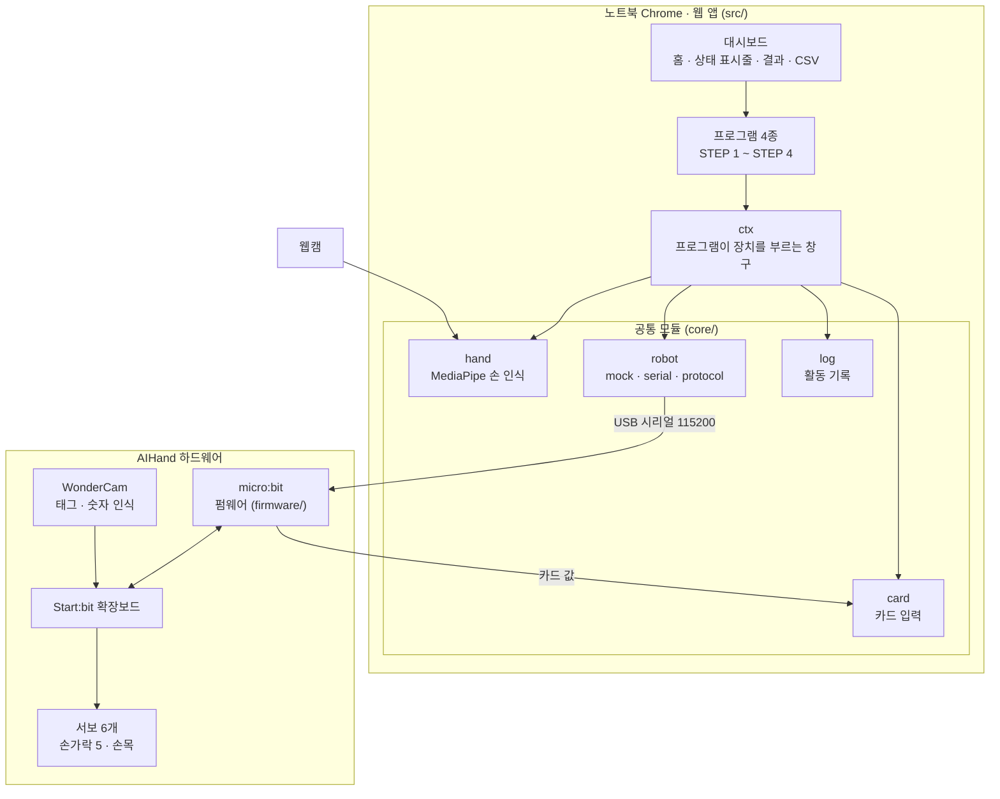

# aihand-care

AIHand 로봇손과 함께하는 **어르신 두뇌·손 놀이 활동** 웹 앱입니다.
로봇손이 손모양을 보여주고 반응하며, 어르신은 손과 카드로 답합니다.

2026 청년 피지컬AI 일경험 프로젝트 · 4인 팀

**바로 써 보기: <https://namong118.github.io/aihand-care/>** (PC의 Chrome에서 열어 주세요. 하드웨어가 없으면 Mock 모드로 동작합니다.)

---

## 1. 프로젝트 소개

화면 속 그림 대신 **실물 로봇손**이 손가락을 접고 펴며 문제를 내고, 맞히면 칭찬하고 틀리면 "다시 해 볼까요" 몸짓으로 반응합니다.
피지컬 AI의 기본 흐름인 **센서 입력 → 웹 판단 → 로봇 출력**이 한 활동 안에서 화면과 실물로 동시에 보이도록 설계했습니다.

- 교구 주제 02 "AI 협동로봇 기반 신호 전달·협업 지원 서비스" (적용 예시: 교육·훈련 보조)
- 노트북 1대 + AIHand 1대를 USB로 연결
- 하드웨어가 없어도 모든 프로그램이 **Mock(가상) 모드**로 끝까지 동작

| 단계 | 프로그램 | 한 줄 설명 | 로봇 역할 |
|---|---|---|---|
| STEP 1 | 기억손 | 로봇이 보여준 손모양을 기억했다가 같은 순서로 만들기 (→ 숫자 카드 순서 기억으로 변경 예정) | 차례로 보여준 뒤 손을 내림 |
| STEP 2 | 사고력 가위바위보 | "져주세요" 같은 조건을 읽고 맞는 손 내기 | 가위바위보 손 내기 |
| STEP 3 | 색깔손 | 글자 뜻이 아니라 **글자 색**과 같은 색깔 카드 보여주기 | 카드 인식, 반응 |
| STEP 4 | 손운동 코칭 | 로봇 시범을 보면서 손동작 따라 하기 | 시범 손모양을 든 채 기다림 |

## 2. 시스템 아키텍처



핵심은 **ctx**입니다. 프로그램은 장치를 직접 만지지 않고 `ctx.robot.showPose('V')`처럼 ctx에 요청만 합니다.
그래서 로봇이 Mock이든 실물이든 프로그램 코드는 바뀌지 않고, 팀원은 각자 자기 프로그램 폴더만 개발하면 됩니다.

## 3. 명령 한 번의 흐름

STEP 1에서 로봇이 브이(가위)를 보여주는 순간을 따라가 보면 이렇습니다.

```
STEP 1 코드         ctx.robot.showPose('V')
  ↓
core/robot          Mock이면 화면 속 로봇손이 움직이고 끝
  ↓ (실물일 때)
serial.js           protocol.js로 "POSE,V" 를 만들어 USB로 전송
  ↓
micro:bit 펌웨어     확장보드로 서보 명령 전송 → 손가락이 움직임
  ↓
micro:bit 펌웨어     "DONE,POSE" 응답
  ↓
STEP 1 코드         응답을 받고 다음 단계로
```

명령은 한 번에 하나씩 보내고, `DONE`이 올 때까지 기다립니다. 정해진 시간 안에 응답이 없으면 상태 표시줄에 알리고 활동은 계속 진행합니다.

## 4. 디렉터리 구조

```
aihand-care/
├─ src/
│  ├─ main.js              앱 시작, 화면 전환
│  ├─ core/                공통 모듈 (담당 A만 수정)
│  │  ├─ context.js        ctx 만들기, 장치 상태
│  │  ├─ robot/            로봇: mock(가상) · serial(실물) · protocol(명령·응답)
│  │  ├─ hand/             손 인식: 웹캠 MediaPipe
│  │  ├─ card/             카드 인식: WonderCam
│  │  └─ log.js            활동 기록
│  ├─ programs/            프로그램 4종 (각자 자기 폴더만 수정)
│  │  ├─ step1-memory/     STEP 1 기억손
│  │  ├─ step2-rps/        STEP 2 사고력 가위바위보
│  │  ├─ step3-stroop/     STEP 3 색깔손
│  │  └─ step4-coach/      STEP 4 손운동 코칭
│  ├─ dashboard/           홈, 장치 상태 표시줄, 결과 화면, 설정
│  ├─ ui/                  공통 화면 부품, styles.css
│  └─ data/                손모양 · 카드 색 · 운동 루틴 데이터
├─ firmware/               micro:bit 펌웨어 (MakeCode)
├─ docs/                   통신 규약, 손 인식 API, 하드웨어 검증 기록, 회의록
└─ .github/workflows/      PR마다 테스트 · 빌드, main 합치면 GitHub Pages 배포
```

프로그램 폴더는 모두 같은 모양입니다. 판정 규칙은 `logic`, 화면은 `screen`, 진행 흐름은 `index`, 담당과 할 일은 `CLAUDE.md`, 그리고 테스트 파일이 있습니다.

## 5. 실행 방법

### 처음 한 번만

1. **Node.js 설치**: <https://nodejs.org> 에서 LTS 버전을 설치합니다. 터미널에서 `node -v`를 입력해 `v22.12.0` 이상이 나오면 됩니다. 그보다 낮으면 테스트 도구(Vitest)가 동작하지 않습니다.
2. **코드 받기**
   ```
   git clone https://github.com/namong118/aihand-care.git
   cd aihand-care
   ```
3. **도구 설치**
   ```
   npm install
   ```

### 실행

```
npm run dev
```

터미널에 나온 `http://localhost:5173` 주소를 **Chrome**에서 엽니다. 로봇 연결에 쓰는 Web Serial은 PC의 Chrome에서만 동작합니다. 끄려면 터미널에서 `Ctrl + C`를 누릅니다.

### 설치 없이 열어 보기 (배포 주소)

<https://namong118.github.io/aihand-care/>

`main`에 PR이 합쳐질 때마다 GitHub Actions가 테스트·빌드한 뒤 이 주소에 자동으로 올립니다(`.github/workflows/deploy.yml`). 반영까지 1~2분 걸립니다. 로봇 연결(Web Serial)도 이 주소에서 Chrome으로 동작합니다.

### 하드웨어 없이 해 보기 (Mock 모드)

- 화면 오른쪽 **가상 로봇손**이 로봇이 할 동작을 손가락 그림으로 보여줍니다.
- **손모양 입력 버튼**은 웹캠 손 인식 대신 씁니다. 한 번 누르면 그 손모양을 들고 있는 것으로 처리되고, **손 내리기**를 누르면 손이 없는 상태가 됩니다.
- **색 카드 입력**은 버튼을 누르거나 키보드 `R`(빨강) `B`(파랑) `Y`(노랑) `G`(초록)을 누릅니다.

### 테스트와 빌드

```
npm test        # 판정 로직 테스트 (Vitest)
npm run build   # 배포용 파일을 dist/ 에 만들기
npm run preview # dist/ 를 배포 주소와 같은 경로(/aihand-care/)로 미리 보기
```

PR을 올리기 전에 두 명령이 모두 통과하는지 확인해 주세요. PR을 올리면 GitHub Actions에서도 자동으로 실행됩니다.

## 6. 하드웨어 구성

| 부품 | 역할 |
|---|---|
| AIHand (Hiwonder) | 서보 6개: 손가락 5개(1~5번) + 손목(6번) |
| micro:bit V2 | 웹과 USB 시리얼로 통신, 확장보드로 서보 명령 전달 |
| Start:bit 확장보드 | 서보 구동, WonderCam 연결 |
| WonderCam | 카드 인식 (태그, 숫자 등 카메라 내장 인식) |
| 노트북 웹캠 | 손 인식 (MediaPipe) |

- 확장보드에는 어댑터 전원이 필요합니다. 전원을 끈 상태에서 micro:bit를 꽂고 켭니다.
- 서보 안전 범위: 손가락 50~130°, 손목 80~100° (펌웨어에 상수로 고정)
- 실물에서 확인한 내용과 날짜는 [docs/hardware-check.md](docs/hardware-check.md)에 기록합니다.

### 펌웨어 올리기

1. <https://makecode.microbit.org> 에서 **새 프로젝트**를 만듭니다. 확장은 추가하지 않습니다.
2. JavaScript 탭에 [firmware/main.ts](firmware/main.ts) 전체를 붙여 넣고 다운로드합니다.
3. micro:bit LED에 버전(F3)이 지나간 뒤 ✓가 나오면 준비 완료입니다. ✖가 나오면 WonderCam을 찾지 못한 것이고, 로봇 동작은 그대로 됩니다.
4. 웹에서 연결하기 전에 **MakeCode 탭을 닫습니다.** 시리얼 포트는 한 프로그램만 쓸 수 있습니다.

자세한 확인 절차는 [firmware/README.md](firmware/README.md)를 봐 주세요.

## 7. 통신 프로토콜 요약

웹과 micro:bit는 USB 시리얼(115200)로 한 줄에 명령 하나씩 주고받습니다.

| 웹 → 로봇 | 동작 | 로봇 → 웹 |
|---|---|---|
| `PING` | 연결 확인 | `PONG` |
| `POSE,<이름>` | 손모양 7종 (ROCK, PAPER, V, INDEX, THREE, FOUR, THUMB) | `DONE,POSE` |
| `HELLO` | 인사 (손목 흔들기) | `DONE,HELLO` |
| `REACT,OK` / `REACT,RETRY` | 칭찬 / 다시 해 볼까요 반응 | `DONE,REACT` |
| `REST` | 쉬는 자세 | `DONE,REST` |
| `SPEED,SLOW` / `SPEED,NORMAL` | 동작 속도 | `DONE,SPEED` |
| `CAM,TAG` / `CAM,NUM` | WonderCam 태그(색 카드) / 숫자 인식 모드 | `DONE,CAM` |
| (명령 없이) | 카드가 바뀌면 태그 번호·숫자, 치우면 NONE | `TAG,<번호>` / `NUM,<1~5>` / `…,NONE` |

잘못된 명령에는 `ERR,UNKNOWN_CMD`, `ERR,UNKNOWN_POSE`, `ERR,BAD_ARG`로 답합니다.
프로토콜을 바꿀 때는 `src/core/robot/protocol.js`, `firmware/`, `docs/protocol.md`를 **같은 PR에서 함께** 고칩니다. 전체 규약은 [docs/protocol.md](docs/protocol.md)에 있습니다.

## 8. 팀 역할

| 담당 | 맡은 부분 | GitHub |
|---|---|---|
| A | 공통 모듈(손 인식·로봇·카드), 통신 프로토콜, 펌웨어, 대시보드, 공통 UI, STEP 1 | [namong118](https://github.com/namong118) |
| B | STEP 4 손운동 코칭 | [jen282](https://github.com/jen282) |
| C | STEP 3 색깔손 | [gksdnd0519-commits](https://github.com/gksdnd0519-commits) |
| D | STEP 2 사고력 가위바위보 | [Juyeon-Kim-pjt](https://github.com/Juyeon-Kim-pjt) |

### 협업 규칙

1. `main`에서 새 브랜치를 만듭니다. 예: `git checkout -b step2/판정로직`
2. 작게 고치고 커밋합니다. 예: `git commit -m "[step2] 판정 함수 추가"`
3. GitHub에 올리고 PR을 만듭니다. 리뷰 후 합칩니다.
4. `main`에 직접 push 하지 않습니다.
5. 자기 폴더 밖 파일을 고쳐야 하면 담당 A에게 먼저 확인받습니다.

자세한 규칙은 [CLAUDE.md](CLAUDE.md)와 각 프로그램 폴더의 `CLAUDE.md`를 봐 주세요.

## 9. 개발 일정

| 기간 | 단계 | 주요 작업 | 점검 |
|---|---|---|---|
| 11/6 – 11/12 | 검증·뼈대 | 하드웨어 검증, 프로토콜 v1, Mock 앱 뼈대, 로봇 시리얼 연결 | 11/12 웹에서 손가락 구동, 태그 ID 수신 |
| 11/13 – 11/19 | 첫 연결 | 웹캠 손 인식, 프로그램 하나 실물로 끝까지 | 11/19 한 프로그램 실물 완주 |
| 11/20 – 11/26 | 프로그램 완성 | 네 프로그램 실물 연결, 카드 입력 | 11/26 미달 프로그램은 Mock 범위로 결정 |
| 11/27 – 12/3 | 안정화 | 정확도 측정, 어르신용 화면 다듬기 | 12/3 코드 동결 |
| 12/4 – 12/7 | 제출 | 시연 영상, 결과보고서, 발표자료 | 12/7 제출 |
