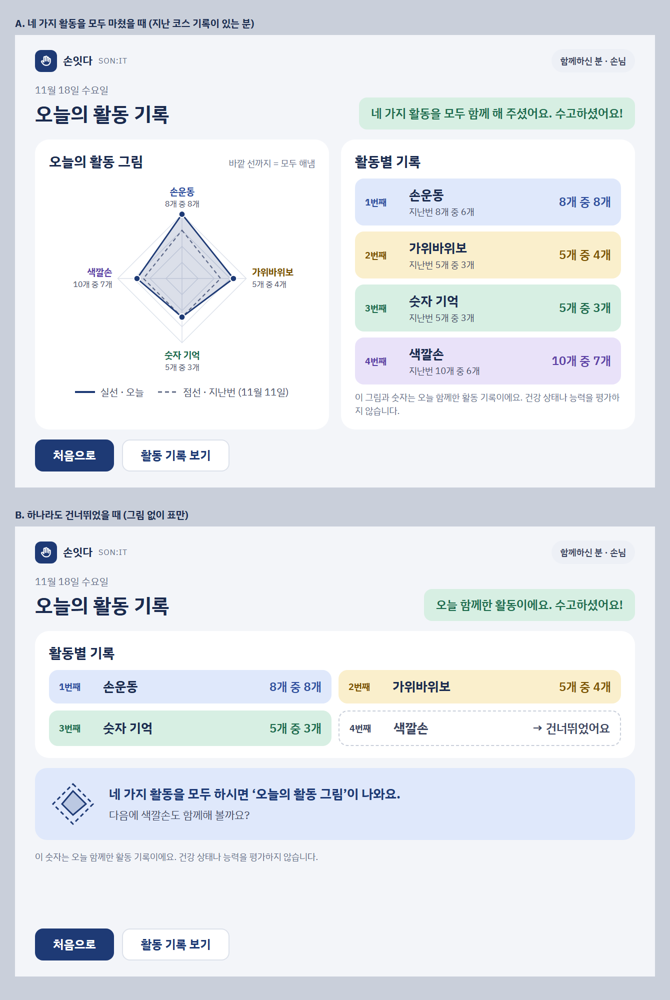

# 오늘의 활동 그림 (방사형) 시안

> 팀 검토용 **화면 시안**이다. 앱 코드는 아직 바꾸지 않았다.
> 화면: `activity-radar.html`을 브라우저로 열거나 `activity-radar.png`를 본다. 화면의 숫자는 모두 **예시**다.

## 무엇인가

코스(오늘의 활동)에서 **네 가지 활동을 모두 마치면**, 코스 끝 화면(`src/dashboard/course.js`의 "오늘의 활동 기록")에 방사형 그림을 더한다.

| 항목 | 정한 안 |
|---|---|
| 꼭짓점 4개 | 활동 이름 그대로: 손운동 · 가위바위보 · 숫자 기억 · 색깔손 (코스 순서, 위에서 시계 방향) |
| 값 | 그 활동의 `done / total` (이미 `ctx.log`에 기록되는 값. 새로 재는 것 없음) |
| 숫자 표시 | "5개 중 4개". %·점수·등급은 쓰지 않는다 |
| 비교 | **본인의 지난 코스 기록**만 점선으로. 표준 기준·또래 평균은 쓰지 않는다. 손님(로그인 안 함)은 지난 기록이 없어 실선만 |
| 하나라도 건너뛰면 | 그림을 그리지 않고 표만. 건너뛴 활동을 0으로 그리면 "전혀 못 했다"로 읽힐 수 있다 |
| 안내 문구 | "이 그림과 숫자는 오늘 함께한 활동 기록이에요. 건강 상태나 능력을 평가하지 않습니다." 항상 표시 |
| 실선/점선 구분 | 색이 아니라 선 모양(실선·점선)과 글자로 구분 (CLAUDE.md "색만으로 정보를 전달하지 않는다") |

## 왜 "능력치 평가"가 아니라 "활동 그림"인가

처음 아이디어는 "STEP 1~4를 마치면 능력치별로 평가해서 방사형으로 보여 주기"였다. 아래 이유로 **활동 기록을 그림으로 보여 주는 안**으로 바꿨다.

1. `docs/decisions.md` 6번: 화면에는 평가·진단처럼 보이는 말 대신 "활동 기록"으로만 표현한다.
2. 기대효과 문서(근거 정리): "우리는 재어 볼 수 있는 것(활동별 완료 수, 반응 시간 변화, 코스를 끝까지 마친 횟수)만 잰다."
3. `docs/research/evidence.md`의 연구들은 MMSE·MoCA 같은 **전문가가 시행하는 검사 도구**로 결과를 쟀다. 우리 활동 점수를 "기억력 ○점"으로 바꿀 기준을 준 연구는 없다. 기준 없이 능력치를 보여 주면 어르신·보호자가 진단처럼 받아들일 수 있다.

## 팀에서 정할 것

- 이 안으로 갈지 (멘토 피드백 회의: `docs/decisions.md` 4-1 "점수표 표현은 멘토 피드백 팀 회의에서 따로 정한다")
- 만든다면 담당: 코스 끝 화면은 A 담당(`src/dashboard/`)
- 7인치(1280×720)에 맞추기: 시안은 1280×900이라 아래 버튼까지 조금 스크롤된다. 그림을 줄이거나 표를 접는 방법 검토
- 그림 안 글자 크기: 시안에서는 그림이 줄어들며 꼭짓점 글자가 24px보다 작아진다. 실제로 만들 때 24px 이상으로 맞춘다
